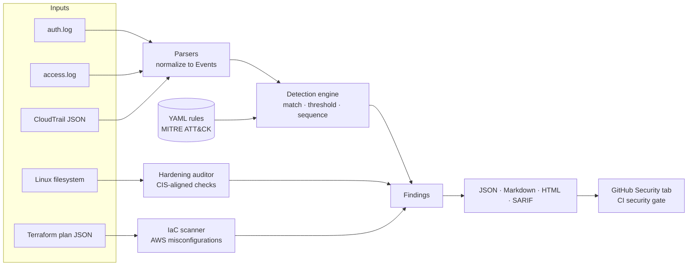

# SecWatch

[](https://github.com/radhika-0401/secwatch/actions/workflows/ci.yml)


**A defensive security toolkit for detection engineering, Linux hardening audits, and
cloud infrastructure-as-code scanning.** SecWatch parses Linux, web server, and AWS
CloudTrail logs, runs YAML detection rules mapped to MITRE ATT&CK, audits hosts against
CIS-aligned hardening checks, and scans Terraform plans for AWS misconfigurations before
they are deployed. Results are written as JSON, Markdown, HTML, and SARIF, so findings can
appear directly in GitHub's Security tab.

It ships with realistic sample data containing two full attack chains (a Linux host
compromise and an AWS account takeover), and the test suite proves every planted attack
is detected without false positives on normal user activity.

## Why I built this

I wanted one project that touches the daily work of several security teams: a SOC analyst
triaging alerts, a detection engineer writing rules, a cloud security engineer reviewing
Terraform, and a GRC analyst checking configuration against a benchmark. Each module is
small enough to read in one sitting, but they are designed to work together, the way a real
security program layers detection, prevention, and posture management.

## Architecture



## Features

| Module | What it does | Skills demonstrated |
|---|---|---|
| **Log parsers** | Normalize Linux `auth.log` (sshd, sudo, useradd), Apache/Nginx combined logs, and AWS CloudTrail into one event model | Log analysis, regex, Linux internals, AWS |
| **Detection engine** | Sigma-inspired YAML rules with three rule types: single-event **match**, sliding-window **threshold** (with distinct counting), and multi-stage **sequence** correlation | Detection engineering, threat detection |
| **20 detection rules** | SSH brute force and password spraying, successful login after brute force, UID 0 backdoors, SQL injection, path traversal, scanners, CloudTrail tampering, IAM privilege escalation, and more, each mapped to MITRE ATT&CK | MITRE ATT&CK, incident response |
| **Hardening auditor** | Read-only checks for SSH configuration, UID 0 accounts, empty passwords, password aging, and file permissions on credential files | CIS Benchmarks, system hardening, GRC |
| **IaC scanner** | Scans `terraform show -json` output for open SSH/RDP, public S3, unencrypted RDS/EBS, wildcard IAM policies, and weak CloudTrail settings | Cloud security, Terraform, shift-left security |
| **Reporting** | JSON for automation, Markdown for tickets, self-contained HTML for humans, SARIF for GitHub code scanning | Security communication, documentation |
| **CI/CD** | GitHub Actions with lint, Bandit SAST, tests on 3 Python versions with coverage gate, SARIF upload, a Terraform security gate, and Docker build; Dependabot keeps dependencies current | DevSecOps, CI/CD, containers |

See [docs/DETECTIONS.md](docs/DETECTIONS.md) for the full rule catalog and
[docs/THREAT_MODEL.md](docs/THREAT_MODEL.md) for a STRIDE threat model of the sample
environment that maps every threat to a detection and a preventive control.

## Quick start

```bash
git clone https://github.com/radhika-0401/secwatch.git
cd secwatch
python -m venv .venv && source .venv/bin/activate   # Windows: .venv\Scripts\activate
pip install -e ".[dev]"

make test    # run the test suite
make demo    # run every scanner on the sample data, reports land in ./reports
```

### Detect threats in logs

```bash
secwatch detect \
  --auth sample_data/auth.log \
  --web sample_data/access.log \
  --cloudtrail sample_data/cloudtrail.json \
  --year 2026 -o reports -f json,md,html,sarif
```

```text
CRITICAL  AUTH-004      Successful SSH login after repeated failures            src_ip=203.0.113.45
CRITICAL  AUTH-006      Local account created with UID 0                        user=sysupdate
CRITICAL  AWS-003       CloudTrail logging stopped or deleted                   user=svc-reporting, event_name=StopLogging
HIGH      AUTH-001      SSH brute force against a single account source         src_ip=203.0.113.45
HIGH      AUTH-002      SSH password spraying across many usernames             src_ip=203.0.113.77
HIGH      AWS-005       Administrator policy attached to an identity            user=svc-reporting
HIGH      WEB-001       SQL injection attempt in request                        src_ip=192.0.2.150
...
```

### Audit a Linux host (read-only)

```bash
secwatch harden --root sample_data/linux_root   # audit the sample filesystem
sudo secwatch harden --root /                    # audit the current machine
```

### Scan Terraform before deploying

```bash
terraform plan -out plan.out
terraform show -json plan.out > plan.json
secwatch iac --plan plan.json --fail-on high     # exits 1 if high or critical findings exist
```

`--fail-on` turns any scanner into a CI security gate. The pipeline in this repo scans an
intentionally insecure configuration ([infra/terraform/main.tf](infra/terraform/main.tf))
to demonstrate findings, then gates the build on the hardened version
([infra/terraform/secure/main.tf](infra/terraform/secure/main.tf)), which must pass clean.

### Run with Docker

```bash
docker build -t secwatch .
docker run --rm -v "$PWD:/work" secwatch iac --plan sample_data/tfplan.json -o reports
```

The image runs as a non-root user.

## Example output

Committed example reports are in [docs/example-reports](docs/example-reports): open
`detect.html` in a browser for the interactive view, or read
[detect.md](docs/example-reports/detect.md) directly on GitHub.

## Sample attack scenarios

The sample data is generated by [scripts/generate_sample_data.py](scripts/generate_sample_data.py)
with a fixed random seed, so it is reproducible. It mixes hundreds of normal events with
these planted scenarios:

1. **Linux host compromise:** 40 failed SSH passwords against `deploy`, a successful login,
   `sudo cat /etc/shadow`, a UID 0 backdoor account, and an edited `authorized_keys`.
2. **Password spraying:** one IP trying nine different common usernames.
3. **Web attacks:** Nikto content discovery, `.env` and `.git` probing, sqlmap SQL injection,
   and path traversal.
4. **AWS account takeover:** failed console logins, AccessDenied permission probing with
   stolen keys, a login without MFA, a new access key, AdministratorAccess, SSH opened to the
   world, and CloudTrail stopped.

All IP addresses are from RFC 5737 documentation ranges and all account IDs are fake.

## Project structure

```text
secwatch/
├── secwatch/
│   ├── parsers/          # auth.log, web access log, CloudTrail → Event
│   ├── detections/       # rule loader + match/threshold/sequence engine
│   ├── rules/            # YAML detection rules (MITRE ATT&CK mapped)
│   ├── hardening/        # CIS-aligned Linux checks
│   ├── iac/              # Terraform plan scanner
│   ├── reporting/        # JSON, Markdown, HTML, SARIF writers
│   └── cli.py
├── tests/                # unit + end-to-end scenario tests
├── sample_data/          # generated logs, sample Linux root, Terraform plans
├── infra/terraform/      # insecure demo config and its hardened fix
├── scripts/              # reproducible sample data generator
├── docs/                 # detection catalog, threat model, example reports
├── .github/workflows/    # CI/CD pipeline
└── Dockerfile
```

## Design decisions

**Rules as data, not code.** Detections live in YAML so analysts can add or tune them without
touching Python, and each rule carries its own ATT&CK mapping and remediation guidance.

**Fewer, better alerts.** Match rules collapse repeated hits per entity, and threshold rules
emit one finding per burst instead of one per event. Alert fatigue is a real operational
problem, so the engine is built to avoid it.

**Correlation beats volume.** Forty failed logins are high severity; forty failed logins
followed by a success is critical. The sequence rule type exists to express that difference.

**Scan the plan, not the HCL.** Terraform plan JSON has variables and modules resolved, so
the scanner sees what will actually be deployed.

**Read-only by default.** Nothing in SecWatch modifies the systems it audits, and the
hardening checks accept any filesystem root, so they work on live hosts, disk images, and
container filesystems.

## Roadmap

- Splunk HEC and SIEM export for findings
- IP reputation and geolocation enrichment (impossible-travel detection)
- Sigma rule import
- Streaming mode for tailing live logs
- More IaC coverage (KMS key rotation, VPC flow logs, GCP and Azure resources)

## License

MIT. See [LICENSE](LICENSE). For responsible use and vulnerability reporting, see
[SECURITY.md](SECURITY.md).
